<a href="https://abdelmaksoud.dev">
  <picture>
    <source media="(prefers-color-scheme: dark)" srcset="assets/hero-dark.svg">
    <source media="(prefers-color-scheme: light)" srcset="assets/hero-light.svg">
    
  </picture>
</a>

<picture>
  <source media="(prefers-color-scheme: dark)" srcset="assets/terminal-dark.svg">
  <source media="(prefers-color-scheme: light)" srcset="assets/terminal-light.svg">
  
</picture>

<picture>
  <source media="(prefers-color-scheme: dark)" srcset="assets/stack-dark.svg">
  <source media="(prefers-color-scheme: light)" srcset="assets/stack-light.svg">
  
</picture>

  <a href="https://abdelmaksoud.dev">abdelmaksoud.dev</a> ·
  <a href="mailto:mohamed@abdelmaksoud.dev">mohamed@abdelmaksoud.dev</a> ·
  <a href="https://www.linkedin.com/in/helmy16">LinkedIn</a>

